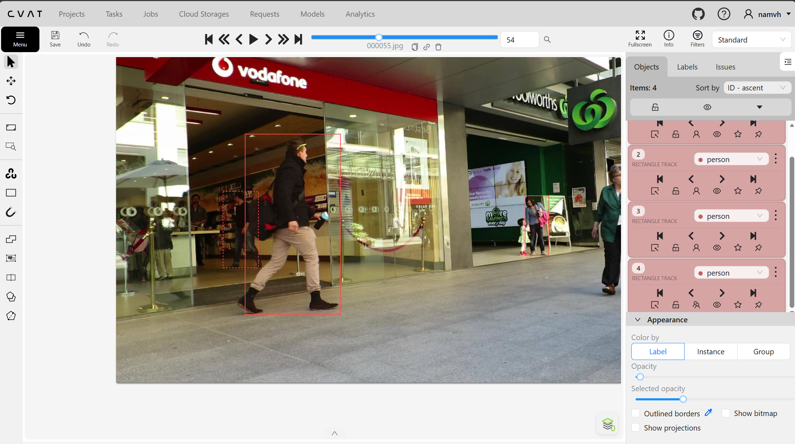
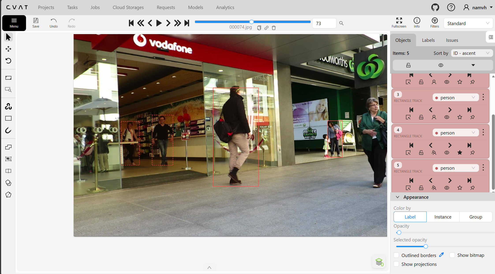
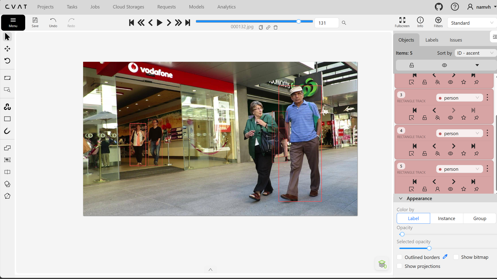

# Báo cáo cá nhân — HoVaTen-MSSV

Đổi tên file theo quy tắc `MSSV_HoTen.md`. Ví dụ: `20241234_NguyenVanAn.md`.

Đoạn video: MOT17-09, 150 frame (frame 1–150), nguồn MOTChallenge, giấy phép CC BY-NC-SA 3.0.

## 0. Thông tin học viên

- Họ tên: Vũ Hoàng Nam
- MSSV: 2A202603268
- Mã đề (A/B/C): C
- Email: 26ai.namvh3@vinuni.edu.vn
- Link repository: https://github.com/hoangnam312/K5-L2-Vu_Hoang_Nam-2A202603268-MOTTracking
- Giờ bắt đầu: 4:30PM
- Giờ kết thúc: 6:00PM

## 1. Xem trước đoạn video (CP0)

Ghi **trước khi vẽ**, mỗi người một dòng.

| Mã | Frame xuất hiện | Frame cuối thấy được | Rẽ / dừng / đổi tốc độ ở frame | Bị che ở frame | Ghi chú |
|---|---|---|---|---|---|
| P1 | 0 | 149| rẽ | 0 | |
| P2 | 61 | 149 | rẽ | 61 | |
| P3 | 0 | 149 | | 0 | |
| P4 | 0 | 105 | dừng | 90 | |
| P5 | 0 | 149 | 45 | 110 | |

## 2. Keyframe và thời gian (CP1, CP4)

Số keyframe lấy từ kết quả `src/check_submission.py`.

| Mã | Số keyframe | Keyframe ở frame | Số frame có mặt | Keyframe / 100 frame | Thời gian (phút) | Chỗ khó |
|---|---|---|---|---|---|---|
| P1 | 16 | 0, 10, 20, 30, 40, 50, 60, 70, 80, 90, 100, 110, 120, 130, 140, 149 | 150 | 10,7 | 0,08 | Đoạn chuyển động đều, đặt đều mỗi 10 frame |
| P2 | 18 | 0, 10, 20, 30, 40, 50, 60, 70, 80, 90, 100, 110, 112, 117, 119, 126, 133, 149 | 150 | 12,0 | 0,08 | Bị che; đặt thêm keyframe ở các đoạn thay đổi hình dạng / vị trí |
| P3 | 11 | 0, 10, 20, 30, 40, 50, 60, 70, 80, 90, 100 | 150 | 7,3 | 0,08 | Chuyển động tương đối đều |
| P4 | 23 | 0, 10, 20, 30, 50, 60, 70, 73, 78, 80, 90, 96, 97, 98, 99, 100, 101, 106, 110, 120, 130, 140, 149 | 150 | 15,3 | 0,08 | Có nhiều đoạn cần chỉnh dày hơn, đặc biệt quanh frame 73, 78 và 96–101 |
| P5 | 12 | 61, 71, 81, 86, 91, 93, 100, 110, 120, 130, 140, 149 | 89 | 13,5 | 0,05 | Chỉ xuất hiện từ frame 61 |
| **Tổng** | **80** | — | **689** | **11,6** | **0,38** | — |

Keyframe / 100 frame của cả bài = tổng keyframe ÷ tổng số frame có mặt × 100 = 80 ÷ 689 × 100 = **11,6**.

Bạn đặt keyframe nhiều nhất ở người nào? Vì sao (người đó rẽ, dừng, lại gần camera hay bị che)?

P4 có nhiều keyframe nhất (23 keyframe, tương đương 15,3 keyframe / 100 frame). Các keyframe được đặt dày hơn quanh frame 73, 78 và 96–101 để bám các đoạn box thay đổi nhanh hoặc khó nội suy.

## 3. Đoạn bị che (CP2)

Người bị che: `P2`

| Mốc | Frame |
|---|---:|
| Bắt đầu bị che một phần (bật `occluded`) | 60 |
| Mất hẳn (bật `outside`) | |
| Hiện lại (tắt `outside`) | |
| Thấy rõ trở lại (tắt `occluded`) | 101 |

- Thời gian khuất hẳn: ___ frame = ___ giây.
- Quyết định: giữ cùng ID .
- Lý do (trả lời 3 câu: khuất bao lâu so với 60 frame, ngoại hình có khớp, chỗ hiện lại có đúng hướng và tốc độ):
   - khuất bao lâu so với 60 frame: nếu định nghĩa từ khuất theo occluded thì thời gian khuất là 41 frames
   - ngoại hình có khớp: có
   - chỗ hiện lại có đúng hướng và tốc độ: có

...

Ảnh chụp màn hình:





## 4. Tự review ID (CP3)

Lượt 1 theo người (đi ngược từ frame 149 về 0 trên CVAT), lượt 2 theo cảnh (nhảy 10 frame). Ít nhất 3 dòng; không có lỗi thì ghi một dòng "đã kiểm hai lượt, không lỗi".

Loại lỗi dùng đúng một trong 7 mã: `id_switch`, `fragmentation`, `lost`, `merge`, `false_track`, `drift`, `flag`.

| Frame | Mã người | Loại lỗi | Mô tả một câu | Phát hiện ở lượt | Đã sửa? |
|---:|---|---|---|---|---|
| 0 | P3 | flag | Khi người mới xuất hiện mỗi cánh tay trong khung hình đánh occluded | 2 | đã sửa |
| 0 | P5 | flag | Khi người mới xuất hiện nửa người trong khung hình đánh occluded | 2 | đã sửa |
| 83 | P2 | flag | Người bị che bởi mép bàn nhưng không đánh occluded | 1 | đã sửa |
| 149 | P5 | lost | Người bị xuất hiện phần chân ở frame cuối cùng | 2 | đã sửa |

Tổng hợp số lỗi theo loại:

| `id_switch` | `fragmentation` | `lost` | `merge` | `false_track` | `drift` | `flag` |
|---:|---:|---:|---:|---:|---:|---:|
| 0 | 0 | 0 | 0 | 0 | 0 | 3 |

Lỗi nào chỉ lượt 2 (theo cảnh) mới thấy, lượt 1 (theo người) không thấy? Vì sao?
Có 3 lỗi chỉ lượt 2 mới thấy, lượt 1 không thấy vì: 
- lỗi này là do lab codes chỉ do bản thân hiểu sai guide lines không phải do tự check(P2b)
- không để ý kĩ phần chân chìa ra (P5)
...

## 5. File xuất và kết quả tự kiểm (CP4)

| Kiểm tra | Kết quả |
|---|---|
| Tên file MOT 1.1 | VuHoangNam_mot.zip |
| Tên file CVAT for video 1.1 | VuHoangNam_cvat_video.zip |
| Số track ID khác nhau trong `gt/gt.txt` (phải là 5) | 5 |
| Frame `outside` không có dòng trong `gt.txt` (đúng / sai) | đúng |
| Job đã completed trên CVAT máy cá nhân | đã |

Dán phần tóm tắt in ra từ `src/check_submission.py`:

```text
Số frame in theo CVAT (bắt đầu từ 0). Trong gt.txt, frame_id = frame CVAT + 1.

=== File MOT 1.1: VuHoangNam_mot.zip ===
  Số track ID: 5   |   Tổng số box: 689
  [OK]        Đúng 5 track ID.

  Track | Frame có mặt | Số frame | Đoạn vắng (outside)
      1 |   0–149      |      150 | -
      2 |   0–149      |      150 | -
      3 |   0–149      |      150 | -
      4 |   0–149      |      150 | -
      5 |  61–149      |       89 | -


=== File CVAT for video 1.1: VuHoangNam_cvat_video.zip ===

  Track | Nhãn   | Frame thấy | Keyframe | KF/100 frame | Frame occluded | Lần bật outside
      0 | person |        150 |       16 |         10.7 |             70 |               0
              Track 0: keyframe ở frame [0, 10, 20, 30, 40, 50, 60, 70, 80, 90, 100, 110, 120, 130, 140, 149]
      1 | person |        150 |       18 |         12.0 |             80 |               0
              Track 1: keyframe ở frame [0, 10, 20, 30, 40, 50, 60, 70, 80, 90, 100, 110, 112, 117, 119, 126, 133, 149]
      2 | person |        150 |       11 |          7.3 |             60 |               0
              Track 2: keyframe ở frame [0, 10, 20, 30, 40, 50, 60, 70, 80, 90, 100]
      3 | person |        150 |       23 |         15.3 |            150 |               0
              Track 3: keyframe ở frame [0, 10, 20, 30, 50, 60, 70, 73, 78, 80, 90, 96, 97, 98, 99, 100, 101, 106, 110, 120, 130, 140, 149]
      4 | person |         89 |       12 |         13.5 |              0 |               0
              Track 4: keyframe ở frame [61, 71, 81, 86, 91, 93, 100, 110, 120, 130, 140, 149]

  Tổng: 80 keyframe / 689 frame có mặt = 11.6 keyframe / 100 frame
  [OK]        Đọc được 5 track từ annotations.xml.

=== Tóm tắt ===
  Lỗi: 0   |   Cảnh báo: 0
  Đạt. Dán phần tóm tắt này vào báo cáo mục 5.
```

## 6. Ba câu kết

1. Nếu được gán lại, bạn sẽ đặt keyframe khác ở đâu? Vì sao?

   ở thời gian người dùng chuyển động đột ngột. Vì đây là thời điểm người dùng dễ out khỏi frame nhất

2. Có chỗ nào bạn không chắc "cùng ID hay ID mới"? Bạn đã quyết định và ghi chú thế nào?

   Không có chỗ nào

3. Một lỗi ID trong job của bạn (nếu không còn sót, chọn lỗi đã sửa) có thể làm xe tự lái dự đoán sai chuyển động của người đó như thế nào? Lỗi đó ảnh hưởng MOTA hay IDF1 nhiều hơn?

   Không có lỗi nào 

## Bonus (nếu làm)

### B1 — Hai người đi sát
src\exports\VuHoangNam_mot_bonus_b1.zip
...

### B2 — So cách đặt keyframe

| Cách đặt | Số keyframe | Frame trôi nhất | Ghi chú |
|---|---:|---:|---|
| Đều mỗi 30 frame | 4 | 41 | |
| Theo chỗ đổi hướng | 4 | 39 | |

report\individual\images\lech_giua_2_keyframe.png
src\exports\VuHoangNam_mot_bonus_b2.zip
...

### B3 — So với tracker có sẵn

| Frame | Mã người | Tracker làm gì | Nhãn của bạn | Giải thích (đoán rồi sửa / ghép IoU / box score thấp / ngoại hình) |
|---:|---|---|---|---|
| | | | | |
| | | | | |

## 7. Tài liệu tham khảo và công cụ AI đã dùng

...
